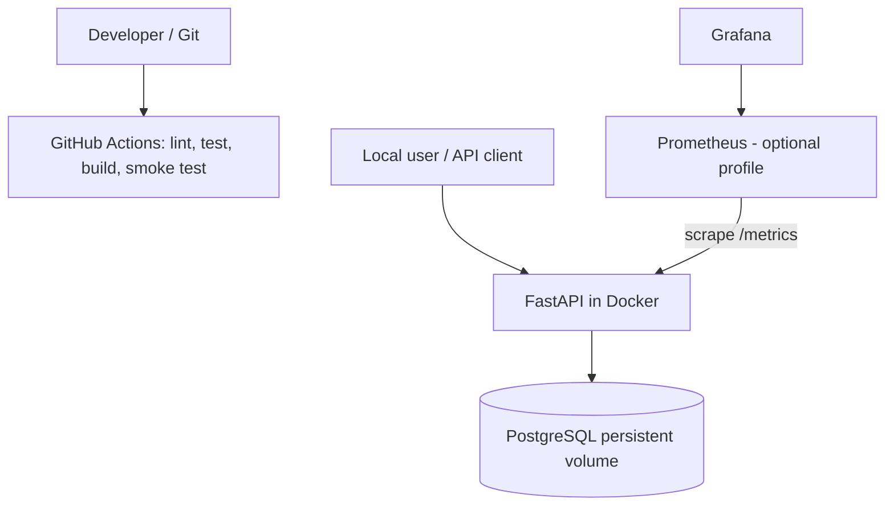

# OpsForge — DevOps Infrastructure Lab

A reproducible local DevOps laboratory with a useful **incident management REST API**, PostgreSQL, optional Prometheus/Grafana monitoring, automated tests, and a real CI pipeline. Built as a portfolio project; Kubernetes and Terraform are scheduled for subsequent milestones, **not** included in v0.1.

## Architecture



- **API**: `/docs` Swagger, incident CRUD subset, `/health/live`, `/health/ready`, `/metrics`.
- **Data**: PostgreSQL persists across `docker compose down` (without `-v`). Database schema managed by Alembic.
- **Runtime**: Docker image runs as a non-root user; app and dashboards listen on loopback only on the Windows host.
- **Observability**: JSON request logs and Prometheus request count/latency metrics; preprovisioned Grafana dashboard.
- **Quality**: Python unit tests, PostgreSQL-backed integration smoke test, lint checks, least-privilege GitHub workflow.

## Requirements

- Windows PowerShell, Docker Desktop (running; Linux containers enabled), Docker Compose v2+, Git.
- Python >=3.12 is **optional for running the application**. It is needed for local unit tests or `scripts/smoke_test.py`.

## Quick start — Windows PowerShell

From the project directory:

```powershell
Copy-Item .env.example .env
# Edit .env, assigning your own local passwords (use letters/digits/hyphens for POSTGRES_PASSWORD).
docker info
docker compose config --quiet
docker compose up -d --build
docker compose ps
Invoke-RestMethod http://localhost:8000/health/ready
```

Open <http://localhost:8000/docs>. Create incidents using the interactive API documentation.

Create an incident directly from PowerShell:

```powershell
$body = @{ title = 'Website unavailable'; description = 'Demo alert'; severity = 'high' } | ConvertTo-Json
Invoke-RestMethod -Method Post -Uri http://localhost:8000/api/v1/incidents -ContentType 'application/json' -Body $body
Invoke-RestMethod http://localhost:8000/api/v1/incidents
```

## Monitoring — optional (uses more RAM)

```powershell
docker compose --profile observability up -d
```

- API: <http://localhost:8000/docs>
- Prometheus: <http://localhost:9090/targets>
- Grafana: <http://localhost:3000> (user `admin`, password from your `.env`)
- In Grafana: **Dashboards → OpsForge → OpsForge API Overview**. Generate API requests to produce metrics.

## Tests

If Python 3.12+ is installed:

```powershell
python -m pip install -e '.[dev]'
python -m pytest -q
ruff check .
python scripts/smoke_test.py
```

The Python unit tests use isolated in-memory SQLite; the smoke test uses the **actual running PostgreSQL service**. GitHub Actions runs both when you push to `main` or create a pull request.

## Operations and troubleshooting

```powershell
docker compose ps
docker compose logs --tail=100 api
docker compose stop                       # Stop without deleting data
# Or stop/remove containers but retain named volumes:
docker compose --profile observability down
# DANGER: the next command deletes the PostgreSQL data as well:
# docker compose down -v
```

If `docker info` fails, open Docker Desktop and wait for the engine to report running; verify Linux containers are enabled. If port 8000, 3000, or 9090 is occupied, change the **host-side** port in `compose.yaml`.

Passwords live in `.env` (gitignored). Do **not** upload `.env` to GitHub. If you previously initialized the PostgreSQL volume with one password and then changed `.env`, you must update the password inside PostgreSQL or recreate a disposable development volume.

## Project milestones

| Milestone | Target | State |
| --- | --- | --- |
| M1 | FastAPI + PostgreSQL + Compose + Alembic + tests | Implemented; verify locally |
| M2 | Prometheus + Grafana + dashboard | Configured; verify locally |
| M3 | CI/CD to a container registry, image scanning, release tags | Planned |
| M4 | Kubernetes with kind, manifests/Helm, rollout/rollback | Planned |
| M5 | Terraform-managed infrastructure, reproducible deployment | Planned |
| M6 | Alerts, load testing, failure drills, screenshots and runbooks | Planned |

## Tradeoffs and limits

- This is a **local laboratory**, not an internet-facing production deployment. There is no authentication or TLS; expose ports publicly only after designing and implementing access control.
- Prometheus metrics currently assume one Uvicorn worker. Multiprocess workers need the Prometheus multiprocess configuration.
- Python dependencies use compatible version ranges in `pyproject.toml`; a lockfile and pinned container image digests are a later reproducibility improvement.
- On a low-RAM Windows machine, run only the API + PostgreSQL by default. Turn on monitoring when needed and shut down afterward.

See [docs/DECISIONS.md](docs/DECISIONS.md) for design choices.
