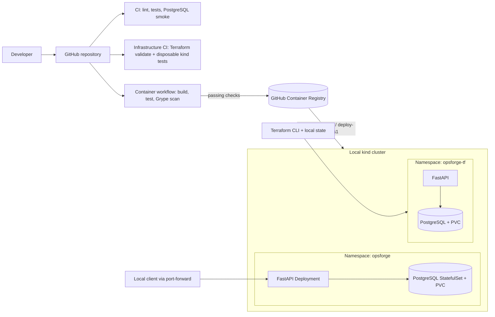
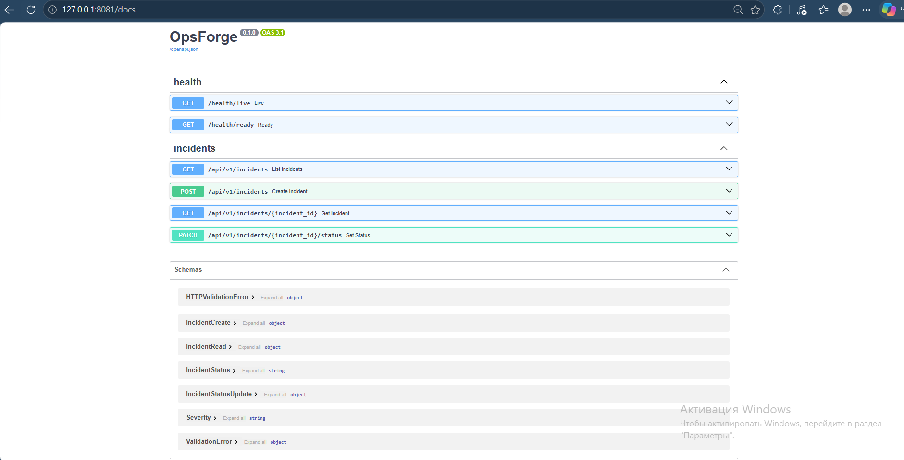
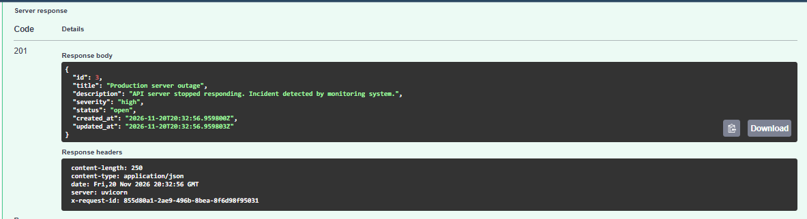
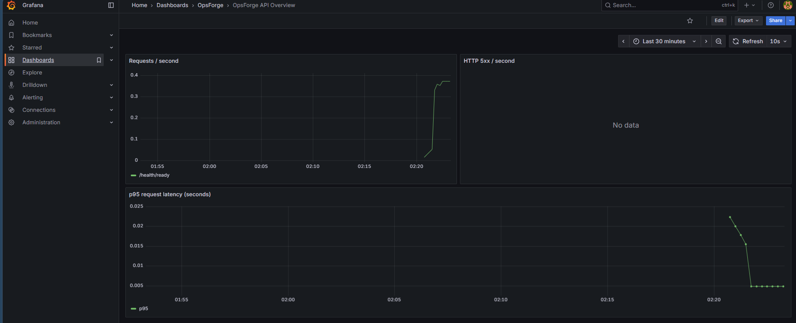
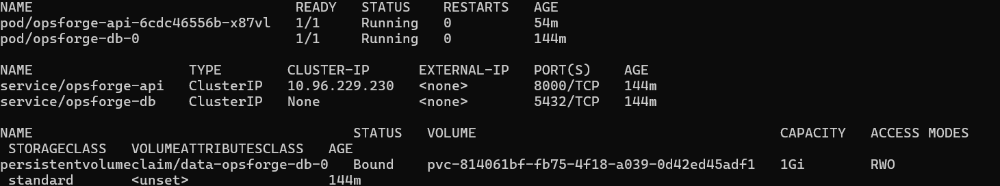
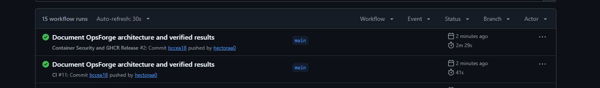
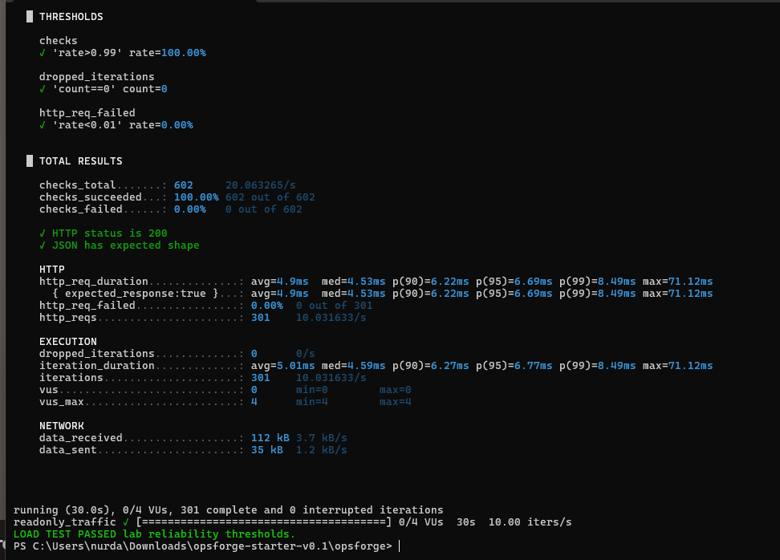
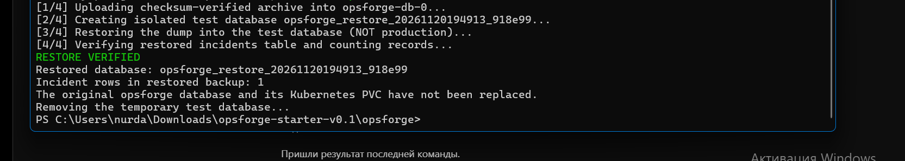

# OpsForge — DevOps Infrastructure & Delivery Lab

[](https://github.com/hectoraa0/opsforge/actions/workflows/ci.yml)
[](https://github.com/hectoraa0/opsforge/actions/workflows/infrastructure.yml)
[](https://github.com/hectoraa0/opsforge/actions/workflows/container-image.yml)

**A reproducible local DevOps platform built around an incident-management API.** It demonstrates containerization, automated tests, observability, Kubernetes operations, Terraform-managed infrastructure, image security scanning, release delivery, database recovery, and measured performance.

> **Scope:** This is a hands-on **local infrastructure lab**, not a public production service. The deployment was exercised on Windows + Docker Desktop + kind. The `opsforge` (kubectl-managed) and `opsforge-tf` (Terraform-managed) namespaces are deliberately separate.

## At a glance

| Area | What is implemented and verified |
| --- | --- |
| **Application & data** | FastAPI incident REST API, PostgreSQL 17, Alembic migrations, Swagger UI |
| **Containers** | Dockerfile, Docker Compose, non-root API process, persistent PostgreSQL volume |
| **Observability** | Prometheus metrics and a provisioned Grafana API dashboard via optional Compose profile |
| **CI** | Ruff lint, pytest unit tests, Docker/PostgreSQL smoke test on GitHub Actions |
| **Infrastructure CI** | Terraform formatting/validation, disposable kind deployment, API smoke test and Pod self-healing test |
| **Kubernetes** | Namespace, Deployment, StatefulSet, Services, Secret, PVC, health probes, resource limits |
| **Infrastructure as code** | Terraform provisions a **separate** `opsforge-tf` namespace/environment; local state is gitignored |
| **Container supply chain** | Grype image scan; successful checks gate GHCR publication under a full-commit-SHA tag and `main` |
| **Release delivery** | Explicitly approved local GHCR-to-kind deployment with rollout/readiness checks and best-effort rollback |
| **Recovery & performance** | PostgreSQL logical backup + checksum + isolated restore test; Grafana k6 read-only tests at 5 and 10 RPS |

## Architecture



**Monitoring is a separate, optional Docker Compose profile:** Prometheus scrapes FastAPI `/metrics`; Grafana reads Prometheus and displays the `OpsForge API Overview` dashboard. It is not automatically deployed into the kind cluster by the Kubernetes manifests.

## Technology stack

**Python 3.12 · FastAPI · SQLAlchemy · Alembic · PostgreSQL · Docker / Compose · Kubernetes (kind / kubectl) · Terraform · GitHub Actions · GHCR · Grype · Prometheus · Grafana · k6 · PowerShell**

## Quick start — Docker Compose

Requirements: Docker Desktop running with Linux containers, Docker Compose, Git and Windows PowerShell. Python 3.12+ is needed for local tests but not to run the containers.

```powershell
git clone https://github.com/hectoraa0/opsforge.git
cd opsforge
Copy-Item .env.example .env
notepad .env   # replace example passwords with your own local values
docker compose config --quiet
docker compose up -d --build
Invoke-RestMethod http://127.0.0.1:8000/health/ready
```

Open **Swagger UI:** http://127.0.0.1:8000/docs

Try an incident:

```powershell
$body = @{ title = 'API recovery drill'; description = 'Local demonstration'; severity = 'high' } | ConvertTo-Json
Invoke-RestMethod -Method Post -Uri http://127.0.0.1:8000/api/v1/incidents -ContentType 'application/json' -Body $body
Invoke-RestMethod http://127.0.0.1:8000/api/v1/incidents
```

Optional monitoring (requires more RAM):

```powershell
docker compose --profile observability up -d
```

Open **Grafana:** http://127.0.0.1:3000 (user `admin`, password from `.env`); **Prometheus targets:** http://127.0.0.1:9090/targets. The preprovisioned dashboard is **Dashboards → OpsForge → OpsForge API Overview**.

To stop containers **without deleting database volumes**, use `docker compose --profile observability down`. **Do not use `down -v` unless you deliberately intend to delete stored data.**

## Local Kubernetes & Terraform

The initial application can be deployed to kind using the included PowerShell script. Requirements: Docker Desktop, `kind`, `kubectl`, a ready `kind-opsforge` context and a local `.env`.

```powershell
kind create cluster --name opsforge     # once, if you do not already have this cluster
kubectl config use-context kind-opsforge
powershell -NoProfile -ExecutionPolicy Bypass -File .\scripts\deploy-kind.ps1
kubectl --context kind-opsforge -n opsforge get pods,svc,pvc
```

The API can then be accessed by opening a **separate terminal** and leaving this process running:

```powershell
kubectl --context kind-opsforge -n opsforge port-forward svc/opsforge-api 8081:8000
```

Use http://127.0.0.1:8081/docs. See [Kubernetes deployment instructions](docs/KUBERNETES.md) for the tested Pod replacement / self-healing drill.

Terraform manages an **independent** environment in namespace `opsforge-tf`, not the above namespace. It was applied locally and validated with a functioning API and database. See [Terraform walkthrough](docs/TERRAFORM.md) and [Terraform module instructions](terraform/kind/README.md). **Never commit `terraform.tfstate` or local `.tfvars`.**

## CI, image scanning & delivery

Three GitHub Actions workflows serve different purposes:

1. **[CI](.github/workflows/ci.yml)** — lint, Python unit tests, Docker Compose integration smoke test.
2. **[Infrastructure CI](.github/workflows/infrastructure.yml)** — Terraform validation and a short-lived kind integration/self-healing test on a GitHub runner.
3. **[Container Security and GHCR Release](.github/workflows/container-image.yml)** — build, test and Grype-scan the same Docker image before publishing to GHCR. Critical findings fail the scan gate; a passing scan does **not** mean the image has no vulnerabilities.

Published image: `ghcr.io/hectoraa0/opsforge:main` (moving tag). Prefer immutable **commit-addressed tags**, such as `ghcr.io/hectoraa0/opsforge:sha-<full-git-commit-sha>`, for repeatable deployments.

**Delivery is intentionally manual (pull-based):** GitHub Actions does not have access to the developer's laptop. The local `scripts/deploy-release.ps1` checks the intended target, downloads a selected GHCR release, loads it into kind, updates both API and init container images, and checks the rollout and readiness. It attempts `kubectl rollout undo` on failure. This is **not** unattended continuous deployment or zero-downtime deployment.

See [release and rollback runbook](docs/DELIVERY.md), [container publishing notes](docs/CONTAINER_RELEASE.md), and [CI design](docs/INFRA_CI.md).

## Verified database recovery

A PostgreSQL custom-format `pg_dump` is generated inside the Kubernetes database Pod and copied as a binary file to Windows. A SHA-256 checksum is recorded; a separate throwaway database is created to test `pg_restore` and query the restored `incidents` table.

**Observed result:** `RESTORE VERIFIED`, including **1 restored incident row**, without replacing the original database or its PVC. The backup is stored locally and is excluded from Git. This is a tested **logical backup workflow**, not scheduled off-site disaster recovery or point-in-time recovery.

See [Backup & Restore runbook](docs/BACKUP_RESTORE.md).

## Verified k6 load tests

Read-only traffic (~80% incident-list requests, ~20% readiness requests) was sent from Windows to local Kubernetes through `kubectl port-forward`. Each run lasted 30 seconds; no data was created, updated or deleted.

| Observed metric | Target 5 RPS | Target 10 RPS |
| --- | ---: | ---: |
| Completed HTTP requests | 151 | 301 |
| Achieved RPS | 5.03 | 10.03 |
| Mean request duration | 4.74 ms | 4.90 ms |
| **p95 request duration** | **6.98 ms** | **6.69 ms** |
| p99 request duration | 8.26 ms | 8.49 ms |
| Maximum request duration | 10.16 ms | 71.12 ms |
| HTTP failures | 0% | 0% |
| Dropped iterations | 0 | 0 |

Both runs passed the configured k6 reliability thresholds. These are **local read-only measurements**, **not** a maximum-throughput benchmark, public-network latency claim, or production SLO. See [methodology and limits](docs/LOAD_TESTING.md).

Reproduce the small baseline with the API port-forward open in a separate terminal:

```powershell
powershell -NoProfile -ExecutionPolicy Bypass -File .\scripts\run-load-test.ps1
# Optional comparison, only when the machine is responsive:
powershell -NoProfile -ExecutionPolicy Bypass -File .\scripts\run-load-test.ps1 -Rps 10 -DurationSeconds 30
```

## Screenshots and verification evidence

All screenshots below come from real **local development lab runs** and GitHub Actions checks, not production services. Test incidents are synthetic demonstration data.

### Application — FastAPI Swagger UI



The application exposes health endpoints and an incident-management REST API via interactive OpenAPI documentation. This is a developer/API interface, not a custom frontend.

<details>
<summary><strong>See a successful incident creation (HTTP 201)</strong></summary>



A synthetic `Production server outage` incident was created through `POST /api/v1/incidents`. The server returned `201 Created`, a generated record ID and `status: open`.

</details>

### Grafana — API observability



The separate `observability` Compose profile provides the Grafana dashboard shown above. The 5xx panel may show **No data** when no 5xx series has been emitted; it is not itself proof that no error occurred.

### Kubernetes — running application and persistent storage



Captured from `kubectl --context kind-opsforge -n opsforge get pods,svc,pvc`: both Pods are `1/1 Running`, and PostgreSQL uses a `Bound` persistent volume claim.

### Automated checks — GitHub Actions



Live status is available via [CI](https://github.com/hectoraa0/opsforge/actions/workflows/ci.yml), [Infrastructure CI](https://github.com/hectoraa0/opsforge/actions/workflows/infrastructure.yml), and [Container Security and GHCR Release](https://github.com/hectoraa0/opsforge/actions/workflows/container-image.yml).

<details>
<summary><strong>See load testing and PostgreSQL backup/restore evidence</strong></summary>

**k6 — 10 RPS read-only local test**



**PostgreSQL — isolated backup restore verification**



The k6 result measures short read-only traffic over a local port-forward, not production throughput. The restore test used a separate temporary database and verified one recovered incident.

</details>

## Repository guide

| Location | Purpose |
| --- | --- |
| [`src/opsforge`](src/opsforge) | FastAPI application, configuration, DB models, metrics |
| [`tests`](tests) | Python tests |
| [`alembic`](alembic) | Database migrations |
| [`infra`](infra) | Prometheus and Grafana provisioned configuration |
| [`k8s`](k8s) | Manual kind Deployment, Services, StatefulSet and storage |
| [`terraform/kind`](terraform/kind) | Terraform-managed second environment |
| [`.github/workflows`](.github/workflows) | CI, infrastructure CI, image publishing |
| [`load`](load) | Read-only k6 test scenario |
| [`scripts`](scripts) | Deployment, release, backup, restore and load-test tooling |
| [`docs`](docs) | Detailed runbooks, decisions and test evidence |

## Engineering trade-offs & next improvements

- **Single API replica and `Recreate` strategy:** startup migrations currently require avoiding concurrent migrations. This can introduce brief downtime. Move migrations to a dedicated Job and design compatible schema changes before enabling rolling updates and multiple replicas.
- **Local and unauthenticated:** endpoints are not protected by application authentication or HTTPS. **Do not expose this lab directly to the internet.** Compose ports are bound to loopback; Kubernetes access is by local port-forward.
- **Terraform state contains sensitive material:** keep state local and gitignored; production use would require a secure backend and controlled access.
- **Recovery scope:** backups are manual, not encrypted off-site, and tested in the same PostgreSQL instance. Add retention, external storage, monitoring and independent restore drills for a real recovery strategy.
- **Supply chain:** scanning blocks critical findings at release time, but further hardening could add signed image attestations, dependency locking and policy enforcement.
- **Performance scope:** load tests are short, read-only and pass through port-forward. Repeat tests under multiple workload mixes and use realistic networking before making capacity claims.

For architecture decisions, see [docs/DECISIONS.md](docs/DECISIONS.md). For a concise demonstration plan, see [docs/DEMO.md](docs/DEMO.md).

**License:** MIT — see [LICENSE](LICENSE).
