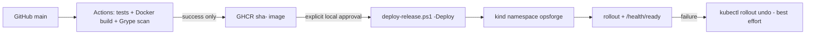

# OpsForge v0.6 — pull-based Continuous Delivery for a local kind cluster

## Why this workflow

GitHub Actions already builds, tests, scans and publishes an image to GHCR. The local kind cluster is on a private Windows machine, so GitHub Actions **must not** be granted direct access to the laptop. A developer explicitly approves the desired release and pulls it into the local cluster using `scripts/deploy-release.ps1`.

**Scope:** this is a **manual approval and promotion** CD demonstration, not unattended cloud Continuous Deployment. It targets ONLY the existing `kind-opsforge` cluster, namespace `opsforge`. It does not alter the Terraform-managed `opsforge-tf` namespace.

## Delivery diagram



## Preconditions

- Docker Desktop running, `kind` cluster `opsforge` ready.
- `kubectl config current-context` is `kind-opsforge`.
- Existing application in namespace `opsforge` deployed through `scripts/deploy-kind.ps1`.
- The image is available in GHCR under a full commit SHA tag, such as `ghcr.io/hectoraa0/opsforge:sha-<40-char-sha>`.
- Windows PowerShell 5.1 or PowerShell 7; Docker, Kind and kubectl on PATH.

## Step 1 — choose a release

Check GitHub Actions > **Container Security and GHCR Release**, then copy the 40-character Git commit SHA for a successful workflow. For the first verified release of this lab:

```
fad03e4fe7efdd35b15777e0d30783c1eed55e83
```

Use the full SHA and not `main`, so you can identify exactly what was deployed.

## Step 2 — preview

From the OpsForge repository root:

```powershell
.\scripts\deploy-release.ps1 -CommitSha fad03e4fe7efdd35b15777e0d30783c1eed55e83
```

This is read-only. It prints current and target images, cluster, namespace, and release strategy; it does NOT pull images or change Kubernetes.

## Step 3 — explicitly approve the release

```powershell
.\scripts\deploy-release.ps1 -CommitSha fad03e4fe7efdd35b15777e0d30783c1eed55e83 -Deploy
```

The script downloads the tagged image, loads it into kind, updates both `api` and `wait-for-db` images, waits for the Deployment, and checks `/health/ready` from inside the running API pod. On failure it **attempts** a Kubernetes revision rollback, but a rollback can also fail.

Inspect the final result:

```powershell
kubectl --context kind-opsforge -n opsforge get pods
kubectl --context kind-opsforge -n opsforge get deployment opsforge-api -o wide
kubectl --context kind-opsforge -n opsforge rollout history deployment/opsforge-api
```

The API is reachable through a separate terminal:

```powershell
kubectl --context kind-opsforge -n opsforge port-forward svc/opsforge-api 8081:8000
```

Then browse `http://127.0.0.1:8081/docs`.

## Rollback / operational safety

- **Recreate:** The API runs one replica because Alembic migrations still run inside the API container. Deployments can have short downtime; this is *not* zero-downtime CD.
- **Database:** `kubectl rollout undo` reverses the Deployment's pod template, **not database migrations**. A schema-changing deployment may make older code incompatible. Before schema changes, add reliable PostgreSQL backups and move migrations to a separate Job with a compatible migration strategy.
- **Rollback history:** Current Kubernetes manifest sets `revisionHistoryLimit: 3`; older revisions eventually disappear.
- **Terraform drift:** This CD script intentionally does not touch `opsforge-tf`, because applying ad-hoc changes to a Terraform-managed Deployment could produce state drift.
- **Registry:** GitHub Action uses image tags `sha-<commit>` and `main`; use full SHA tags for deployment. For future production use, verify signed images and pin to registry digest instead of only relying on tags.
- **Permissions:** The script uses local Docker and kubectl credentials, never commits secrets or Terraform state, and does not expose the laptop to GitHub runners.

## Diagnostic commands

```powershell
kubectl --context kind-opsforge -n opsforge describe deployment opsforge-api
kubectl --context kind-opsforge -n opsforge get events --sort-by=.lastTimestamp
kubectl --context kind-opsforge -n opsforge logs deployment/opsforge-api -c api --tail=100
```

For an intentional manual rollback of an unsuccessful deployment:

```powershell
kubectl --context kind-opsforge -n opsforge rollout undo deployment/opsforge-api
kubectl --context kind-opsforge -n opsforge rollout status deployment/opsforge-api --timeout=180s
```

**Do not use `terraform destroy`, `kind delete cluster`, or `kubectl delete namespace` as part of a normal rollback** — those could destroy stored data.
