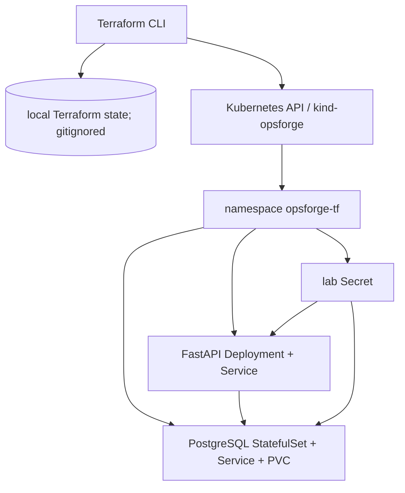

# Terraform / IaC milestone (OpsForge v0.3)

This milestone demonstrates an independently managed environment in a disposable Kubernetes namespace using the HashiCorp Kubernetes and Random providers.

**Do not import the currently running `opsforge` namespace.** Terraform owns only `opsforge-tf`, allowing the earlier manual Kubernetes deployment to remain untouched.

Quick start: see [`terraform/kind/README.md`](../terraform/kind/README.md).

## Architecture

## Why isolated state?

The original `opsforge` resources were created via `kubectl apply`. Adopting these existing resources into Terraform ownership would require careful import, drift comparison and state migration, especially for the stateful database. A separate namespace is safer for hands-on learning and makes the effect of `terraform plan`, `apply`, and `destroy` visible without threatening the working environment.

## Operational considerations

- Confirm `terraform plan` shows the intended **new** resources before applying.
- Never commit state files: state contains an automatically generated PostgreSQL password. `.gitignore` is extended locally before `terraform init`.
- Run `kubectl --context kind-opsforge -n opsforge-tf get pods,svc,pvc` after apply; confirm API readiness via port-forward.
- Because the image is local, a new Kind cluster needs the `opsforge-api:kind` image loaded again using `kind load docker-image`.
- The lab is not production-ready: no TLS, no public ingress, no backups, no real secret vault, no CD from Actions.
